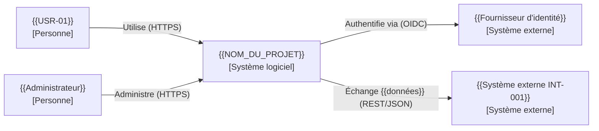
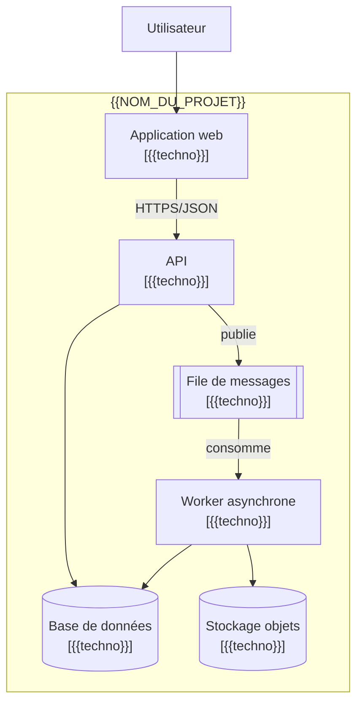
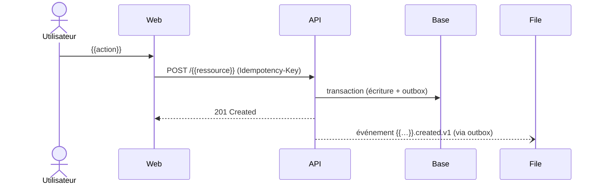
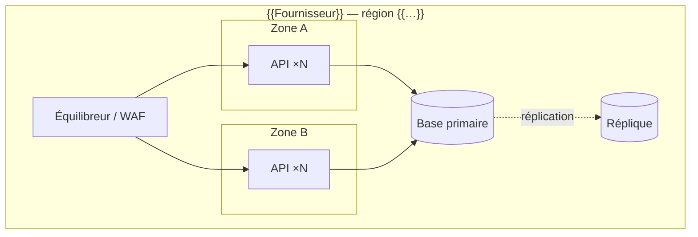

# Architecture du système — {{NOM_DU_PROJET}}

> **Ce document dit COMMENT le système est structuré et POURQUOI.** Il est inspiré d'**arc42** et du **modèle C4**, conforme à l'esprit d'ISO/IEC/IEEE 42010 (parties prenantes → préoccupations → vues → décisions).
>
> Il référence les exigences par identifiant (`FR-*`, `NFR-*`, `CON-*`) sans recopier leurs valeurs, et enregistre les décisions sous forme d'**ADR**.

<!-- MODE D'EMPLOI
- Les diagrammes sont écrits en texte (Mermaid, PlantUML, Structurizr DSL) et versionnés : ils évoluent avec le code.
- Préférer « juste assez » d'architecture : chaque section doit aider une décision ou une compréhension. Indiquer « Non applicable : … » plutôt que supprimer une section.
- Toute décision structurante (difficile à changer, coûteuse, ou touchant plusieurs équipes) → ADR (section 12).
-->

---

## 0. Contrôle du document

| Version | Date | Auteur | Changements | Approuvé par |
|---|---|---|---|---|
| 0.1.0 | `{{AAAA-MM-JJ}}` | `{{…}}` | Création | `{{…}}` |

---

## 1. Exigences déterminantes et objectifs de qualité

### 1.1. Résumé fonctionnel
`{{Deux à cinq phrases : ce que fait le système et pour qui. Détail : requirements.md.}}`

### 1.2. Exigences architecturalement significatives

| Exigence | Pourquoi elle structure l'architecture | Mécanisme(s) de réponse (section) |
|---|---|---|
| `{{NFR-PERF-001}}` | `{{EX: latence p95 basse sous forte charge → cache, lecture répliquée}}` | `{{§ 11.2}}` |
| `{{NFR-REL-001}}` | `{{EX: haute disponibilité → multi-zone, sans état}}` | `{{§ 9, § 11.3}}` |
| `{{NFR-REL-003}}` | `{{EX: RPO court → PITR}}` | `{{§ 8}}` |
| `{{CON-003}}` | `{{EX: intégration ERP imposée}}` | `{{§ 6}}` |
| `{{NFR-SEC-…}}` | `{{…}}` | `{{§ 11.1}}` |

### 1.3. Priorités de qualité (ordre d'arbitrage)

1. `{{EX: Sécurité}}`
2. `{{EX: Fiabilité}}`
3. `{{EX: Évolutivité / maintenabilité}}`
4. `{{EX: Performance}}`
5. `{{EX: Coût}}`

> En cas de compromis, la qualité la mieux classée l'emporte, sauf ADR contraire.

### 1.4. Parties prenantes de l'architecture

| Rôle | Préoccupations principales | Vues utiles |
|---|---|---|
| Développeurs | Modules, dépendances, conventions | § 4, § 5 |
| Exploitation / SRE | Déploiement, supervision, reprise | § 9, § 11 |
| Sécurité | Frontières de confiance, données | § 3, § 8, § 11.1 |
| `{{…}}` | `{{…}}` | `{{…}}` |

---

## 2. Contraintes architecturales

| Contrainte | Origine (`CON-*`) | Conséquence architecturale |
|---|---|---|
| `{{EX: Cloud imposé : …}}` | `{{CON-003}}` | `{{…}}` |
| `{{EX: Données hébergées dans l'UE}}` | `{{CON-001}}` | `{{régions autorisées : …}}` |
| `{{EX: Équipe de 4 développeurs, compétences …}}` | organisationnelle | `{{favorise un monolithe modulaire}}` |

---

## 3. Contexte du système (C4 — niveau 1)

> Le système vu comme une boîte noire : utilisateurs, systèmes externes, frontières de confiance.



| Élément externe | Interaction | Intégration (`INT-*`) | Frontière de confiance |
|---|---|---|---|
| `{{…}}` | `{{…}}` | `{{INT-001}}` | `{{Internet → zone publique}}` |

---

## 4. Stratégie de solution et style architectural

### 4.1. Style retenu
`{{EX: Monolithe modulaire / Microservices / Serverless / Architecture hexagonale / Event-driven / Client-serveur / Application mobile + BFF…}}`

### 4.2. Justification
- **Adéquation aux exigences :** `{{…}}`
- **Adéquation au contexte (équipe, délais, coûts) :** `{{…}}`
- **Alternatives écartées :** `{{… → voir ADR-001}}`

### 4.3. Principes d'architecture du projet

| ID | Principe | Implication |
|---|---|---|
| `PRIN-01` | `{{EX: Le domaine métier ne dépend d'aucun framework ni infrastructure}}` | `{{ports et adaptateurs}}` |
| `PRIN-02` | `{{EX: Services sans état ; état dans des stockages managés}}` | `{{montée en charge horizontale}}` |
| `PRIN-03` | `{{EX: Chaque donnée a un seul composant propriétaire}}` | `{{pas de base partagée}}` |
| `PRIN-04` | `{{EX: Asynchrone pour tout ce qui n'est pas nécessaire à la réponse utilisateur}}` | `{{file de messages}}` |

---

## 5. Vue conteneurs (C4 — niveau 2)

> « Conteneur » = unité déployable ou stockage (application web, API, worker, base de données, file…).



| Conteneur | Responsabilité | Technologie | Données possédées | Exposé à | Mise à l'échelle |
|---|---|---|---|---|---|
| `{{API}}` | `{{…}}` | `{{…}}` | `{{…}}` | `{{Internet via passerelle}}` | `{{horizontale, sans état}}` |

---

## 6. Composants, modules et frontières de dépendance

### 6.1. Décomposition (C4 — niveau 3, pour les conteneurs complexes)

| Module / composant | Responsabilité (une phrase) | Interface publique | Dépend de | Ne doit **pas** dépendre de |
|---|---|---|---|---|
| `{{domain/orders}}` | `{{règles de gestion des commandes}}` | `{{OrderService}}` | `{{domain/shared}}` | `{{infrastructure, frameworks web}}` |
| `{{application}}` | `{{orchestration des cas d'usage}}` | `{{…}}` | `{{domain}}` | `{{adaptateurs}}` |
| `{{infrastructure/…}}` | `{{adaptateurs base, messages, API externes}}` | `{{…}}` | `{{domain (ports)}}` | — |

### 6.2. Règles de dépendance

```text
{{EX:
interfaces (web, CLI, consommateurs)  →  application  →  domaine
infrastructure (adaptateurs)          →  application / domaine (implémente les ports)
Le domaine ne dépend de rien d'autre que de lui-même.}}
```

- **Vérification automatique :** `{{EX: ArchUnit, dependency-cruiser, import-linter, règles de modules}}` en CI.
- Une violation de ces règles est un défaut S2 minimum (voir `AP-201`, `AP-202`).

---

## 7. Vues dynamiques : flux et interactions

> Documenter les scénarios **significatifs** (critiques, complexes, ou impliquant plusieurs composants) — pas tous.

### 7.1. Scénario `{{UC-001 — titre}}`



- **Contrats :** `{{lien vers OpenAPI / AsyncAPI}}` (conventions : `rules/api-conventions.md`)
- **Gestion d'erreurs et délais :** `{{…}}`
- **Garanties (cohérence, ordre, idempotence) :** `{{…}}`

### 7.2. Points d'intégration externes

| `INT-*` | Pattern d'intégration | Délais / retries | Comportement en cas d'échec | Contrat |
|---|---|---|---|---|
| `{{INT-001}}` | `{{appel synchrone via adaptateur + circuit breaker}}` | `{{…}}` | `{{NFR-REL-004}}` | `{{…}}` |

---

## 8. Architecture des données

### 8.1. Modèle conceptuel
`{{Diagramme entité-relation (Mermaid erDiagram) ou lien ; entités principales et relations.}}`

### 8.2. Inventaire des stockages

| Stockage | Type | Propriétaire (composant) | Données | Classe (`SEC-010`) | Volumétrie (`NFR-CAP-002`) | Niveau de sauvegarde (`BKP-010`) | Localisation |
|---|---|---|---|---|---|---|---|
| `{{…}}` | `{{relationnel / document / clé-valeur / objet / recherche / vectoriel}}` | `{{…}}` | `{{…}}` | `{{…}}` | `{{…}}` | `{{T1}}` | `{{…}}` |

### 8.3. Cohérence et transactions
- Frontières transactionnelles : `{{EX: une transaction ne traverse pas deux agrégats / deux services}}`
- Cohérence inter-composants : `{{EX: éventuelle via outbox transactionnel + consommateurs idempotents (évite AP-702)}}`
- Concurrence : `{{EX: verrouillage optimiste par version / ETag}}`

### 8.4. Cycle de vie des données
- Création / mise à jour / archivage / purge : `{{…}}` (durées : `NFR-PRIV`)
- Migrations de schéma : `{{outil}}`, stratégie *expand / contract* (`REL-065`)

---

## 9. Vue de déploiement



| Environnement | Rôle | Topologie | Différences avec la production |
|---|---|---|---|
| `{{production}}` | `{{…}}` | `{{…}}` | — |
| `{{préproduction}}` | `{{…}}` | `{{…}}` | `{{…}}` |
| `{{développement / prévisualisation}}` | `{{…}}` | `{{…}}` | `{{…}}` |

- **Infrastructure as Code :** `{{outil, emplacement}}`
- **Réseau et segmentation :** `{{zones publiques/privées, accès d'administration}}`
- **Plateforme d'exécution :** `{{Kubernetes, serverless, VM, store mobile…}}`

---

## 10. Technologies retenues

| Domaine | Technologie | Version | Justification / ADR | Licence | Fin de support |
|---|---|---|---|---|---|
| Langage(s) | `{{…}}` | `{{…}}` | `{{ADR-…}}` | `{{…}}` | `{{…}}` |
| Framework(s) | `{{…}}` | `{{…}}` | `{{…}}` | `{{…}}` | `{{…}}` |
| Base(s) de données | `{{…}}` | `{{…}}` | `{{…}}` | `{{…}}` | `{{…}}` |
| Messagerie | `{{…}}` | `{{…}}` | `{{…}}` | `{{…}}` | `{{…}}` |
| Hébergement | `{{…}}` | — | `{{…}}` | — | — |
| Observabilité | `{{OpenTelemetry + …}}` | `{{…}}` | `{{…}}` | `{{…}}` | — |
| Modèle(s) d'IA | `{{fournisseur, modèle, version épinglée}}` | `{{…}}` | `{{…}}` | `{{conditions d'usage}}` | `{{…}}` |

---

## 11. Concepts transverses (mécanismes architecturaux)

> Ici : **comment** l'architecture répond aux exigences de qualité. Les **règles** obligatoires restent dans `rules/` et sont seulement référencées.

### 11.1. Sécurité
- Frontières de confiance et zones : `{{…}}`
- Authentification / autorisation : `{{EX: OIDC via IdP, jetons courts, autorisation centralisée dans le module …}}` (règles : `SEC-030`…`SEC-053`)
- Gestion des secrets : `{{coffre utilisé, injection}}` (`SEC-081`)
- Chiffrement : `{{…}}` (`SEC-070`)
- Modèle de menaces : `{{lien}}` (`SEC-020`)

### 11.2. Performance et montée en charge
- `{{EX: cache (stratégie, invalidation, TTL), CDN, réplicas en lecture, pagination, traitement asynchrone, limites de débit}}`
- Goulots d'étranglement connus : `{{…}}`

### 11.3. Résilience et disponibilité
- `{{EX: redondance multi-zone, délais + retries avec backoff, circuit breakers, bulkheads, dégradation gracieuse, files de lettres mortes}}`
- Modes de défaillance analysés :

| Défaillance | Détection | Impact | Réponse automatique | Exigence |
|---|---|---|---|---|
| `{{Base primaire indisponible}}` | `{{…}}` | `{{…}}` | `{{bascule sur réplique}}` | `{{NFR-REL-001}}` |

### 11.4. Observabilité
- `{{EX: SDK OpenTelemetry dans chaque conteneur, collecteur, backend …}}` (conventions : `rules/observability.md`)

### 11.5. Configuration et gestion des fonctionnalités
- `{{sources de configuration, feature flags, outil}}`

### 11.6. Internationalisation
- `{{EX: textes externalisés, stockage UTC, formatage côté client selon locale}}` (`NFR-I18N-*`)

### 11.7. Multi-locataire (si applicable)
- `{{modèle d'isolation : base partagée + RLS / schéma par locataire / base par locataire}}` (`SEC-053`)

### 11.8. Composants d'IA (si applicable)
- Pattern : `{{EX: RAG, agent avec outils, classification}}`
- Frontière de confiance du modèle, outils exposés et leurs permissions (`SEC-160`…`SEC-164`)
- Évaluation et observabilité (`TST-140`, `OBS-120`)

---

## 12. Décisions d'architecture (ADR)

### 12.1. Index

| ID | Titre | Statut | Date | Remplace / remplacée par |
|---|---|---|---|---|
| `ADR-001` | `{{EX: Choix du style architectural}}` | `{{Proposée / Acceptée / Dépréciée / Remplacée}}` | `{{…}}` | — |

<!-- Les ADR peuvent être rédigées ici ou dans des fichiers dédiés (ex. docs/adr/0001-titre.md). Une ADR acceptée n'est pas modifiée sur le fond : on en crée une nouvelle qui la remplace. -->

### 12.2. Gabarit d'ADR

```markdown
### ADR-<NNN> — <Titre de la décision>
- **Statut :** Proposée | Acceptée | Dépréciée | Remplacée par ADR-…
- **Date :** AAAA-MM-JJ — **Décideurs :** … — **Consultés :** …
- **Contexte :** problème, forces en présence, exigences concernées (NFR-…, CON-…).
- **Options envisagées :**
  1. Option A — avantages / inconvénients / risques / coût / réversibilité
  2. Option B — …
- **Décision :** option retenue.
- **Justification :** pourquoi, au regard des priorités de qualité (§ 1.3).
- **Conséquences :** positives, négatives, dette acceptée, actions de suivi.
- **Validation :** comment vérifier que la décision tient (test, mesure, revue à date).
```

---

## 13. Risques, compromis et dette technique

### 13.1. Risques architecturaux

| ID | Risque | Probabilité | Impact | Atténuation | Responsable | Statut |
|---|---|---|---|---|---|---|
| `ARISK-001` | `{{…}}` | `{{…}}` | `{{…}}` | `{{…}}` | `{{…}}` | `{{…}}` |

### 13.2. Dette technique structurante

| ID | Description | Cause | Impact | Plan de résorption | Échéance | Ticket |
|---|---|---|---|---|---|---|
| `DEBT-001` | `{{…}}` | `{{choix délibéré / imprévu}}` | `{{…}}` | `{{…}}` | `{{…}}` | `{{…}}` |

---

## 14. Scénarios de qualité et validation de l'architecture

> Scénarios concrets permettant de vérifier que l'architecture satisfait les exigences (approche inspirée d'ATAM).

| ID | Qualité | Stimulus | Environnement | Réponse attendue | Mesure (référence exigence) | Méthode de validation |
|---|---|---|---|---|---|---|
| `QS-001` | Performance | `{{pic de charge NFR-CAP-001}}` | `{{production}}` | `{{le système sert les requêtes}}` | `{{NFR-PERF-001}}` | `{{test de charge TST-080}}` |
| `QS-002` | Disponibilité | `{{perte d'une zone}}` | `{{production}}` | `{{bascule automatique}}` | `{{NFR-REL-001}}` | `{{test de résilience TST-083}}` |
| `QS-003` | Évolutivité | `{{ajout d'un moyen de paiement}}` | `{{développement}}` | `{{modification limitée à un adaptateur}}` | `{{≤ N jours, sans modification du domaine}}` | `{{revue}}` |

---

## 15. Glossaire technique

| Terme | Définition |
|---|---|
| `{{…}}` | `{{…}}` |

(Glossaire métier : [requirements.md § 4](requirements.md).)
